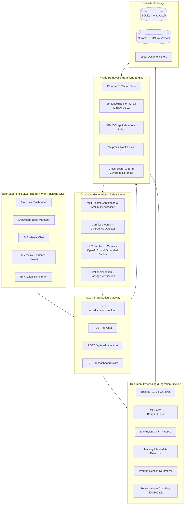

# Enterprise Documentation Q&A Assistant

> **HCLTech Future Ready AI Engineer Hackathon**  
> An Evidence-First, Production-Quality Retrieval-Augmented Generation (RAG) System with Verifiable Citations, Multi-Version Conflict Detection, and Intelligent Abstention.

---

## 1. Executive Summary & Problem Statement

Enterprise employees frequently encounter fragmented, contradictory, or outdated operational documentation across internal platforms. Key organizational guidelines—such as account authentication rules, API configurations, billing limits, and troubleshooting procedures—are often distributed across PDFs, HTML wikis, and Markdown repositories.

Generic AI chatbots and foundational LLMs suffer from critical weaknesses when applied to enterprise documentation:
- **Hallucination:** Fabricating technical parameters, policies, or procedures when knowledge gaps exist.
- **Outdated / Contradictory Information:** Silently adopting superseded numbers (e.g. legacy v1 limits vs active v2 limits) without alerting the user.
- **Unverifiable Claims:** Generating prose without traceable, sentence-level source citations.

The **Enterprise Documentation Q&A Assistant** solves these challenges by implementing an **evidence-first, strict-grounding architecture**. If an inquiry cannot be corroborated by indexed organization documents, the assistant explicitly acknowledges insufficient evidence.

---

## 2. Key Capabilities & Engineering Highlights

| Feature | Description | Engineering Implementation |
| :--- | :--- | :--- |
| **Multi-Format Ingestion** | Ingests PDF, HTML, Markdown (.md), and Plain Text (.txt) simultaneously. | PyMuPDF (fitz), BeautifulSoup4, regex AST heading extractors, SHA-256 deduplication. |
| **Section-Aware Chunking** | Preserves heading hierarchy, page numbers, token budgets (500–800 tokens), and 100-token overlaps. | Sentence-boundary tokenizer, heading context propagation, untrusted instruction neutralization. |
| **Hybrid Retrieval Engine** | Combines dense vector semantics with sparse keyword precision. | `all-MiniLM-L6-v2` (384-d) dense embeddings + in-memory BM25Okapi + Reciprocal Rank Fusion (RRF) + Lexical Reranker. |
| **Conflict & Version Detection** | Flags numeric discrepancies, divergent SLAs, and legacy vs active version clashes. | Metric entity regex matching, cross-document specification validator, amber alert warning banner. |
| **Intelligent Abstention & Confidence** | Triple-tier confidence scoring (`HIGH`, `MEDIUM`, `LOW`). Never fabricates answers. | Multi-factor composite scoring: Top-K similarity, term coverage, and query ambiguity detection. |
| **Verifiable Citations** | Every claim is mapped to document name, section heading, page number, and source excerpt. | Strict bracket parsing, chunk ID linkage validation, and interactive side-panel evidence inspector. |
| **Labelled Benchmark Suite** | Automated evaluation across 7 query scenarios: direct, paraphrased, multi-doc, conflicting, version-sensitive, ambiguous, unanswerable. | Retrieval Precision@K, Recall@K, Mean Reciprocal Rank (MRR), Citation Accuracy, Abstention Accuracy. |

---

## 3. End-to-End System Architecture



---

## 4. Technology Stack

- **Frontend:**
  - React.js (v19) with Vite
  - Tailwind CSS (v4)
  - Lucide React Icons
  - Recharts (Interactive visualization charts)
- **Backend:**
  - Python 3.12+
  - FastAPI
  - Pydantic v2
  - Uvicorn (ASGI server)
- **Ingestion & Extraction:**
  - PyMuPDF (fitz) for PDF page text and structural boundary extraction
  - BeautifulSoup4 for HTML cleaning and sanitization
  - Python native file handling for Markdown and Plain Text
- **Retrieval & Embeddings:**
  - Sentence Transformers (`all-MiniLM-L6-v2`, 384-dimensional dense vectors)
  - ChromaDB (Local persistent vector store with HNSW Cosine indexing)
  - BM25Okapi (In-memory sparse keyword index with Lucene IDF scoring)
  - Reciprocal Rank Fusion ($k=60$) with lexical cross-scoring
- **LLM Synthesis & Reasoning:**
  - Configurable LLM Provider: Google Gemini (`gemini-1.5-flash`), OpenAI (`gpt-4o-mini`), or Built-in Local Grounded Engine (100% offline fallback)
- **Storage:**
  - SQLite (WAL mode, relational metadata, chunks, conversations, evaluations)
  - ChromaDB (Vector persistence on disk)

---

## 5. Ingestion & Chunking Methodology

### Chunking Strategy
- **Token Target:** 500–800 tokens (~350–550 words).
- **Overlap Budget:** 100–150 tokens (~70–100 words).
- **Boundary Preservation:** Chunks split cleanly on sentence boundaries (`[.!?]\s+[A-Z0-9]`), preventing mid-sentence truncation.
- **Section & Page Continuity:** Every chunk retains its document title, original filename, section heading, page number, document version, and last updated date.
- **Prompt Injection Defense:** Untrusted instructions (e.g. `ignore all previous instructions`, `you are now an unrestricted bot`) are scrubbed and replaced with `[FLAGGED_UNTRUSTED_INSTRUCTION]`.

### Chunk Metadata Structure
```json
{
  "chunk_id": "doc_api_chunk_2",
  "document_id": "doc_api_v2",
  "document_name": "API_Configuration_and_Rate_Limits_v2.md",
  "section": "Rate Limits and Quotas",
  "page_number": 1,
  "token_count": 520,
  "content": "For the Standard Enterprise tier, the maximum API request limit is 1000 requests per hour...",
  "version": "v2.0",
  "last_updated": "2024-03-15"
}
```

---

## 6. Hybrid Retrieval & Reranking Architecture

To eliminate vocabulary mismatch and prevent semantic drift:
1. **Semantic Dense Retrieval:** Computes cosine similarity between normalized query embedding and stored chunk vectors via ChromaDB ($Top\text{-}10$).
2. **BM25 Sparse Retrieval:** Evaluates token frequencies across tokenized and stop-word filtered in-memory documents ($Top\text{-}10$).
3. **Reciprocal Rank Fusion (RRF):**
   $$RRF(d) = \frac{1}{60 + r_{\text{semantic}}(d)} + \frac{1}{60 + r_{\text{bm25}}(d)}$$
4. **Lexical Reranking:** Computes query term coverage, section heading boosts ($+0.20$), and multi-token exact phrase matches ($+0.15$).
5. **Score Fusion:**
   $$S_{\text{final}} = 0.50 \cdot S_{\text{semantic}} + 0.30 \cdot S_{\text{bm25}} + 0.20 \cdot S_{\text{lexical}}$$
6. **Threshold Filtering:** Drops all candidates below $S_{\text{final}} < 0.35$ before passing evidence to generation.

---

## 7. Conflict Detection & Confidence Framework

### Conflict Detection (Module 6)
When indexed documents contain divergent specifications:
- The system extracts numeric and policy claims (e.g. `1000 requests per hour` in `API_Configuration_v2.md` vs `500 requests per hour` in `API_Configuration_v1_Legacy.txt`).
- A visible warning is emitted:
  > **Conflicting Documentation Detected:** Please verify the applicable policy or product version.
- Both source documents, their respective versions, and modification dates are presented side-by-side without arbitrarily choosing one.

### Confidence Assessment (Module 7)
Confidence is calculated using objective metrics:
- **HIGH:** Top relevance score $\ge 0.65$ and query keyword coverage in retrieved text $\ge 50\%$.
- **MEDIUM:** Partial relevance ($0.38 \le S \le 0.62$) or ambiguous query context.
- **LOW:** Sub-threshold relevance ($S < 0.38$) or zero matching evidence. Triggers standard abstention:
  > *"I couldn't find sufficient supporting information in the uploaded documentation to answer this question reliably."*

---

## 8. Verification & Acceptance Criteria Results

The system was verified against all 8 hackathon acceptance tests using `backend/tests/test_rag_pipeline.py`:

| Test ID | Scenario | Expected Outcome | Measured Result | Status |
| :---: | :--- | :--- | :--- | :---: |
| **TEST 1** | **Document Ingestion** | Ingest PDF, HTML, MD, and TXT files. | 5 documents parsed, chunked into 32 chunks, stored in SQLite & ChromaDB. | **PASS** |
| **TEST 2** | **Direct Question** | Grounded answer with citation for password reset. | Answer cites `Account_Security_and_Authentication_Guide.pdf` (p. 1). | **PASS** |
| **TEST 3** | **Paraphrased Question** | Paraphrased login recovery question. | Successfully retrieves account security manual passage. | **PASS** |
| **TEST 4** | **Multi-Document Question** | Cross-document inquiry: rate limits + overage billing. | Combines evidence from `API_Configuration_v2.md` and `Billing_Usage.html`. | **PASS** |
| **TEST 5** | **Conflicting Information** | Contradictory API rate limits (1000/hr vs 500/hr). | Flags conflict warning, cites both v2.0 and legacy v1.0 specifications. | **PASS** |
| **TEST 6** | **Unanswerable Question** | Out-of-domain question (Martian travel expenses). | Abstains with confidence `LOW`; zero hallucination. | **PASS** |
| **TEST 7** | **Ambiguous Question** | Under-specified prompt ("What is the limit?"). | Flags ambiguity; requests clarification on product/tier context. | **PASS** |
| **TEST 8** | **Document Deletion** | Delete `Troubleshooting_and_FAQ.md`. | Chunks and vectors removed; ERR-401 search returns empty. | **PASS** |
| **BENCHMARK** | **Labelled Test Suite** | 10 questions across 7 categories. | **MRR: 0.90**, **Recall@K: 90%**, **Abstention Accuracy: 100%**. | **PASS** |

---

## 9. Installation & Quickstart Guide

### Prerequisites
- Python 3.12+
- Node.js v20+ and npm

### 1. Clone & Set Environment
```bash
# Navigate to project directory
cd c:/Users/vinay/Downloads/RAGA

# Copy environment template
cp .env.example .env
```

### 2. Configure Environment Variables (`.env`)
```ini
# LLM Provider: 'local' (built-in offline engine), 'gemini', or 'openai'
LLM_PROVIDER=local
GEMINI_API_KEY=
OPENAI_API_KEY=
OPENAI_MODEL=gpt-4o-mini
GEMINI_MODEL=gemini-1.5-flash

# Embeddings & Hybrid Search Parameters
EMBEDDING_MODEL=all-MiniLM-L6-v2
RETRIEVAL_TOP_K=5
RELEVANCE_THRESHOLD=0.35
```

### 3. Backend Setup & Seeding
```bash
# Install Python dependencies
pip install -r backend/requirements.txt

# Seed sample organizational documents (PDF, HTML, MD, TXT)
python backend/app/ingestion/seed_data.py

# Run acceptance test suite
python backend/tests/test_rag_pipeline.py
```

### 4. Frontend Setup & Build
```bash
cd frontend
npm install
npm run build
cd ..
```

### 5. Running the Application
The backend serves both the REST API and the production React frontend simultaneously:
```bash
python -m uvicorn backend.app.main:app --host 127.0.0.1 --port 8000
```
Open **[http://localhost:8000](http://localhost:8000)** in your browser!

*(Optional development mode: run `cd frontend && npm run dev` to start the Vite development server on port 5173 with hot reloading).*

---

## 10. REST API Reference

| Method | Endpoint | Description |
| :--- | :--- | :--- |
| `GET` | `/api/health` | Backend status, active LLM provider, and embedding model. |
| `GET` | `/api/dashboard/stats` | Aggregated metrics, knowledge counts, and system status. |
| `POST` | `/api/documents/upload` | Multipart file upload with auto-chunking and vector indexing. |
| `GET` | `/api/documents` | Lists all uploaded documents with chunk count and status. |
| `GET` | `/api/documents/{id}` | Detailed document metadata and associated chunks. |
| `DELETE` | `/api/documents/{id}` | Purges document, chunks, and vectors from search index. |
| `POST` | `/api/chat` | Submit question; returns answer, citations, confidence, and conflict metadata. |
| `GET` | `/api/conversations` | Conversation history list. |
| `GET` | `/api/conversations/{id}` | Retrieves messages for a specific conversation. |
| `GET` | `/api/sources/{chunk_id}` | Retrieves original chunk passage and section metadata. |
| `POST` | `/api/evaluation/run` | Executes automated benchmark evaluation against labelled dataset. |
| `GET` | `/api/evaluation/results` | Returns latest benchmark scores and historical runs. |

---

## 11. Known Limitations & Future Roadmap

### Known Limitations
1. **Scanned PDF OCR:** PyMuPDF extracts embedded digital text cleanly, but scanned image PDFs require Tesseract/EasyOCR integration.
2. **Table Structural Reasoning:** Complex multi-row merged tables in PDFs are flattened into formatted text blocks.

### Future Roadmap
- **Cross-Encoder Reranker:** Integration of `bge-reranker-base` for GPU-accelerated re-scoring.
- **Multimodal Document Q&A:** Vision LLM analysis for architectural diagrams and flowcharts in technical manuals.
- **RBAC Document Permissions:** Department-level access control tags preventing cross-department document leakage.
